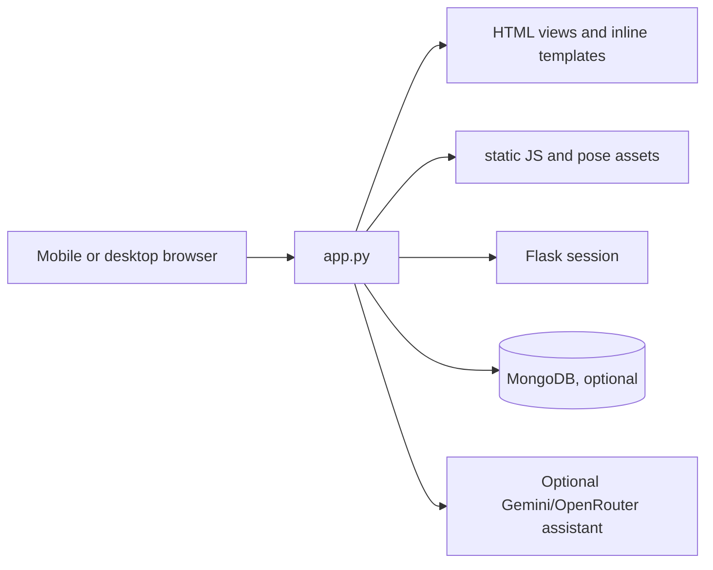

# Anveshan (SUNDAY)


Anveshan is a Flask yoga and wellness prototype branded **SUNDAY**. It provides browser-based guided practice pages, pose assets, account/profile flows, progress actions, and an optional AI assistant backed by MongoDB when configured.

> **Status:** Prototype. Do not use with real identity or health data without reviewing authentication, secrets, privacy, and production controls.

## Demo and assets

- **Hosted demo:** [asanamind.onrender.com](https://asanamind.onrender.com) (availability and deployment configuration are external to this repository).
- **Visual assets:** [pose library](assets/poses/), [practice flow](static/practice-flow.js), [pose cues](static/pose-cues.js), and [voice knowledge](static/voice-kb.js).

## Architecture and workflow



The browser loads the Flask experience, selects a practice, and consumes pose/cue JavaScript. Flask handles authentication, profile/progress requests, and assistant fallback behavior. MongoDB is optional at startup but required for persistent account features.

## Implemented routes

- Pages: `GET /`, `/main`, `/home`, `/profile`, `/manifest.json`, `/sw.js`.
- Auth/profile: `POST /register`, `POST /login`, `GET /logout`, `GET /api/profile`.
- Practice and assistant: `POST /api/complete_pose`, `POST /api/assistant`, `GET /api/commands`, `POST /api/sync-history`.
- Static assets: `GET /assets/<path>`.

Inspect route decorators in `app.py` for the current payload and session contract; this list is a guide, not a versioned API specification.

## Setup

Python 3.11+ is expected.

```bash
python -m venv .venv
. .venv/bin/activate                 # Windows: .venv\\Scripts\\activate
pip install -r requirements.txt
cp .env.example .env
flask --app app run --debug
```

For deployment, `Procfile` declares `gunicorn app:app`. Use HTTPS and a managed MongoDB service.

## Configuration

Copy `.env.example` and set `SECRET_KEY` and `MONGO_URI` for a persistent deployment. `GEMINI_API_KEY`, `OPENROUTER_API_KEY`, `ASANA_MIND_URL`, and `PORT` are optional/runtime settings. Never commit `.env` or paste credentials into issues, screenshots, or documentation.

## Accessibility and mobile notes

The pages include responsive viewport metadata and are intended for phone-sized practice sessions. Test keyboard navigation, focus visibility, color contrast, semantic labels, reduced motion, touch targets, and graceful failure when camera/audio/speech permissions are denied. Browser media support differs across devices.

## Testing and limitations

No comprehensive automated suite is declared. CI compiles the Python modules and checks README-relative links. Manually verify login/registration, profile persistence, practice completion, assistant fallback with no API keys, MongoDB outage behavior, service-worker caching, and narrow-screen layouts.

## Security and privacy

See [SECURITY.md](SECURITY.md). Use a secret manager, rotate credentials, restrict database access, enable secure cookies/HTTPS, and review data retention before production use.

## License

No license file is present; license terms are unspecified until the owner adds explicit terms.
