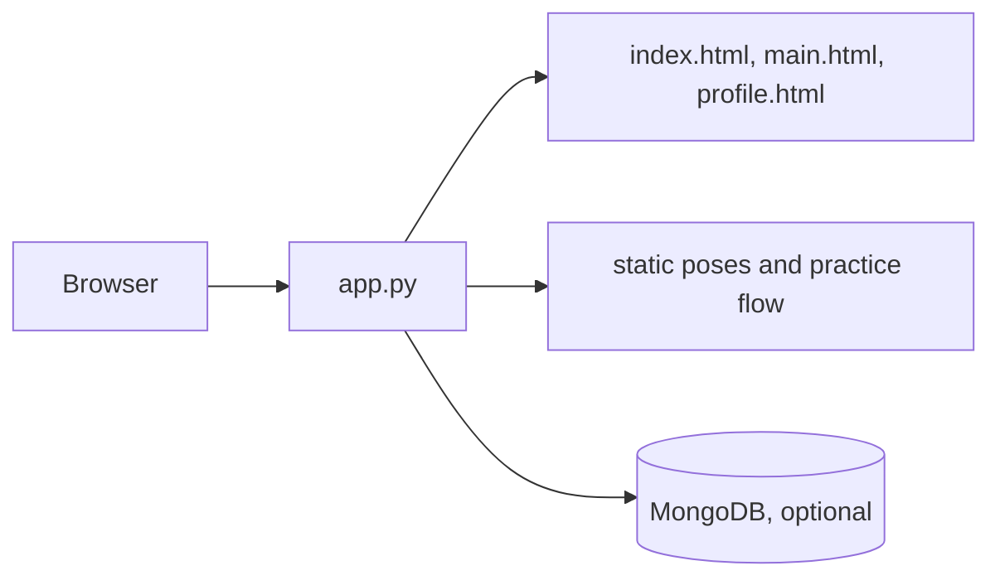

# Anveshan

A Flask-based yoga and wellness application closely related to the Anveshan practice experience. It serves guided practice pages, pose assets, status views, and optional MongoDB-backed user data.

## Architecture



`app.py` is the deployable Flask entrypoint; `assistant.py`, `main.py`, and `main1.py` contain supporting flows. `Procfile` declares Gunicorn deployment.

## Setup

```bash
python -m venv .venv && . .venv/bin/activate
pip install -r requirements.txt
# configure MongoDB and Flask secrets locally
flask --app app run --debug
```

Production command: `gunicorn app:app`.

## Workflow

The browser loads the Flask-rendered pages, selects a practice, and consumes pose/cue JavaScript from `static/`. User/session actions are handled by Flask; MongoDB is used only when configured.

## Deployment

Deploy to a Python host with Python 3.11+, Gunicorn, HTTPS, a strong secret key, and a managed MongoDB connection.

## Testing and limitations

No automated suite is declared. Test authentication/session paths, practice navigation, mobile behavior, and database outages manually. Camera/audio and assistant features depend on browser support and optional services.

## Security and operations

- Keep credentials, database URLs, OAuth tokens, API keys, and signing secrets in environment variables; never commit them.
- Validate and constrain uploaded files and user input at the server boundary, and enable HTTPS in production.
- Review dependency updates and rotate any credential that has appeared in repository history.

## Testing

The repository currently has no comprehensive automated test suite unless noted above. Before production changes, add tests for authentication/authorization, validation failures, persistence errors, and the primary user workflow.

## Limitations and roadmap

This is an actively evolving project. Production hardening, observability, rate limiting, backup/retention policy, and accessibility/performance validation should be completed before handling sensitive or high-volume workloads.

## License

See the repository license file and package metadata for the authoritative terms.
